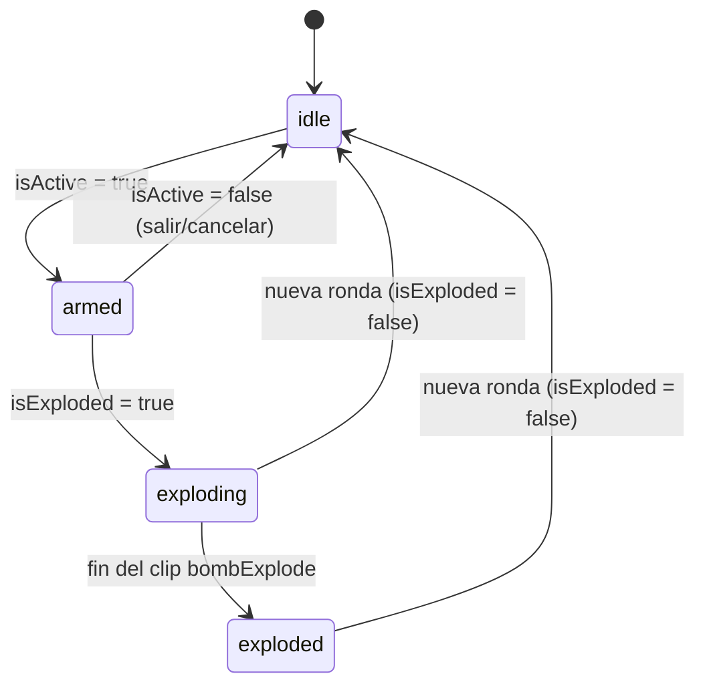
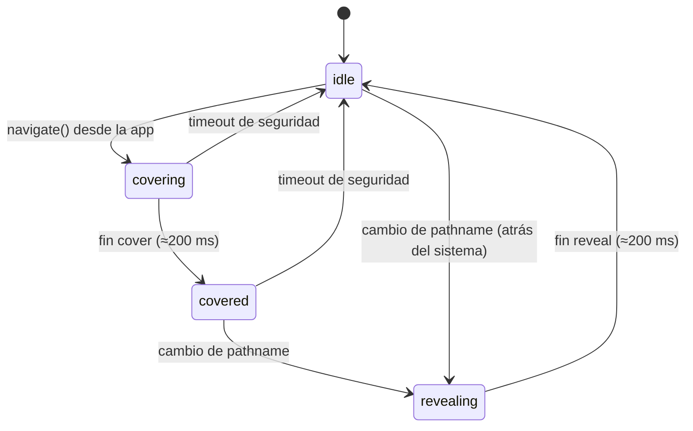

# Data Model: Animaciones y estilo visual pixel art

**Feature**: [spec.md](./spec.md) | **Plan**: [plan.md](./plan.md)

No hay entidades de dominio persistidas nuevas. Las entidades son configuraciones
estáticas (manifiestos/tema) y estados de UI en memoria. Solo `backgroundImage` se
persiste (clave existente de AsyncStorage).

## SpriteSheet

Hoja de fotogramas generada por `scripts/build-sprites.js` y declarada en `theme/sprites.ts`.

| Campo                        | Tipo                       | Regla                                           |
| ---------------------------- | -------------------------- | ----------------------------------------------- |
| `id`                         | `SpriteId` (union literal) | único; `camelCase` (`bombIdle`, `explosion`, …) |
| `source`                     | `ImageSourcePropType`      | `require('../assets/sprites/<id>.png')`         |
| `frameWidth` / `frameHeight` | `number` (px 1×)           | > 0; tamaño del fotograma en el arte original   |
| `columns`                    | `number`                   | ≥ 1                                             |
| `frameCount`                 | `number`                   | 1 ≤ `frameCount` ≤ `columns × rows`             |
| `exportScale`                | `number` entero            | factor del pre-escalado (8–12)                  |

**Validación** (test `sprites.test.ts`): `columns × frameWidth × exportScale ≤ 2048` y
`rows × frameHeight × exportScale ≤ 2048`, con `rows = ceil(frameCount / columns)`.

## AnimationClip

Secuencia reproducible sobre una `SpriteSheet`.

| Campo          | Tipo       | Regla                                                        |
| -------------- | ---------- | ------------------------------------------------------------ |
| `sheet`        | `SpriteId` | debe existir                                                 |
| `frames`       | `number[]` | índices válidos de la hoja; no vacío                         |
| `fps`          | `number`   | 8 ≤ fps ≤ 15 (FR-001)                                        |
| `loop`         | `boolean`  |                                                              |
| `holdLast`     | `boolean`  | si `loop=false`, queda en el último fotograma                |
| `reducedFrame` | `number`   | fotograma estático a mostrar con reducir movimiento (FR-021) |

Clips mínimos: `bombIdle`, `bombArmed`, `bombExplode` (con `holdLast`: su último fotograma
es el humo), `coinSpin`, `coinHeads`, `coinTails`, `loader`, `bgStars` (opcional).

## PixelTheme

Constante en `theme/pixel.ts`, espejada en `tailwind.config.js`.

| Campo        | Tipo                                                                    | Regla                                                                  |
| ------------ | ----------------------------------------------------------------------- | ---------------------------------------------------------------------- |
| `PIXEL_UNIT` | `4` (dp)                                                                | todas las medidas de borde/sombra/desplazamiento son múltiplos         |
| `palette`    | `Record<PaletteKey, string>`                                            | ≤ 16 entradas hex (FR-011)                                             |
| `fonts`      | `{ title: 'PressStart2P_400Regular'; body: 'PixelifySans_400Regular' }` | nombres exportados por `@expo-google-fonts/*`                          |
| `timings`    | `Record<string, number>`                                                | cadencias de [research.md R9](./research.md#r9-cadencias-y-duraciones) |

## BackgroundOption

| Campo          | Tipo                  | Regla                                                                |
| -------------- | --------------------- | -------------------------------------------------------------------- |
| `id`           | `string`              | persistido en AsyncStorage `backgroundImage`; `'default'` y `'city'` |
| `labelKey`     | `string`              | clave i18n `settings.backgrounds.<id>` en `es` y `en`                |
| `source`       | `ImageSourcePropType` | PNG pixel pre-escalado                                               |
| `overlayClip?` | `AnimationClip`       | capa animada opcional; se oculta con reducir movimiento              |

**Regla** (`resolveBackground(id)`, FR-013): id desconocido o vacío → `'default'`. El valor
persistido `'default'` de usuarios actuales sigue siendo válido (ahora apunta al fondo pixel).

## MotionPreference

`'full' | 'reduced'`, derivado de `AccessibilityInfo` por `useReducedMotion()`; no se
persiste. Cambia en caliente con el evento `reduceMotionChanged`.

## BombVisualState (máquina de estados)

Derivado de las props existentes de `Bomb` (`isActive`, `isExploded`), que vienen del
estado de partida de `app/game/index.tsx` (FR-006). Se implementa como función pura
`deriveBombVisualState(isActive, isExploded, explodeClipEnded)` en `theme/animation.ts`.

| Estado      | Clip                                   | Extras                                                      | Con reducir movimiento           |
| ----------- | -------------------------------------- | ----------------------------------------------------------- | -------------------------------- |
| `idle`      | `bombIdle` (bucle)                     | —                                                           | `reducedFrame` estático          |
| `armed`     | `bombArmed` (bucle)                    | temblor ±1 `PIXEL_UNIT`                                     | sin temblor, fotograma estático  |
| `exploding` | `bombExplode` (una vez)                | destello (2×), temblor de pantalla ±2 `PIXEL_UNIT` ≤ 500 ms | salta a `exploded`, sin destello |
| `exploded`  | `bombExplode` (último fotograma, humo) | —                                                           | igual                            |

## TransitionPhase (máquina de estados)

Estado del `PixelTransitionOverlay` global. Transiciones implementadas como reducer puro
`transitionReducer(phase, event)` en `theme/animation.ts`.

- En `idle`: overlay con `pointerEvents="none"` y opacidad 0.
- En cualquier otro estado: `navigate()` se ignora (FR-019).
- Con reducir movimiento: se navega directamente y la fase permanece en `idle`.
